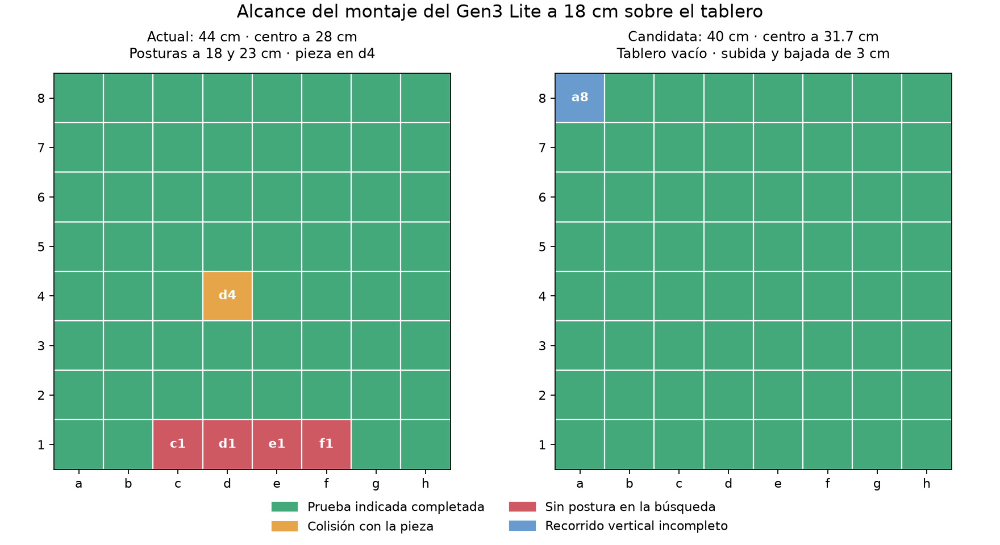

# Evaluación provisional de alcance del Kinova Gen3 Lite

Se compararon posiciones y tamaños del tablero en sesiones ROS independientes
de la simulación abierta. No se ejecutó ningún movimiento ni se modificó
`escena_virtual.json`. Se usó el modelo Kortex Lite, grupo `arm`, montaje
`end_effector_link`, orientación fija Rx(pi), tablero alineado con la base y
superficie a z=0. Todas las alturas se refieren al montaje, no al punto de agarre.



## Resultados

| Prueba | Alturas del montaje | Postura inferior válida | Ambas posturas válidas | Subida/bajada rectas |
|---|---|---:|---:|---:|
| Tablero 44 cm, centro X=28 cm, pieza en d4 | 18 y 23 cm | 59/64 | 59/64 | No comprobadas |
| Tablero 40 cm, centro X=32 cm, pieza en d4 | 18 y 23 cm | 63/64 | 61/64 | No comprobadas |
| Tablero vacío 40 cm, centro X=31.7 cm | 18 y 21 cm | 64/64 | 64/64 | 63/64 |

En la configuración actual de 44 cm/28 cm no se encontró postura inferior en
c1, d1, e1 y f1. En d4 se encontró una postura en colisión con la pieza. La
escena aún no implementa contactos de agarre ni unión de la pieza a la pinza.

En el ensayo de tablero vacío de 40 cm/31.7 cm se encontraron posturas válidas
en todas las casillas a las dos alturas, pero la subida recta desde a8 solo
completó el 93.75 % y no se ejecutó. Centros de 31.8 y 31.9 cm dieron también
64/64 posturas en ambas alturas y 63/64 recorridos verticales; a8 siguió pendiente.
El ensayo de 40 cm/32 cm con subida de 3 cm dio 62/64 recorridos verticales.

Los 40 cm forman parte del rango aproximado proporcionado por el usuario; no
se ha reducido el tablero activo ni se ha cambiado su centro. 40 cm/31.7 cm es
una candidata para seguir investigando, no una configuración validada de agarre.
No basta con desplazar el tablero de 44 cm: al alejarlo se pierden filas lejanas
en las búsquedas realizadas.

## Alcance de la prueba

- Primer barrido: seis semillas, hasta 25 ms por intento de IK, ocho combinaciones
  de lados 40/44 cm y centros 28/30/32/34 cm. En sesiones posteriores se amplió
  a doce semillas y 75 ms por intento para reducir falsos negativos.
- Las posturas se resolvieron primero sin filtro de colisión y después se
  comprobaron con `check_state_validity`. Ninguna solución se envió a un controlador.
- Las subidas y bajadas se calcularon con `compute_cartesian_path`, colisiones
  activas, orientación restringida y rechazo de trayectorias parciales. No se ejecutaron.
- El ensayo de tablero vacío no contiene la pieza, pero sí conserva el tablero
  como obstáculo. Se hizo únicamente en la sesión aislada.
- No encontrar IK no demuestra imposibilidad. Los resultados dependen de la
  semilla, tiempo disponible, precisión del modelo y orientación elegida.
- Faltan las piezas reales, el punto de agarre calibrado, la pieza transportada
  como objeto unido, los demás obstáculos y los traslados entre casillas.
- Las subidas de 3 cm son una prueba geométrica; no se ha validado que proporcionen
  separación suficiente con las piezas reales, especialmente las más altas.

## Repetir

En Ubuntu, desde la raíz del proyecto, con ROS y el workspace cargados:

```bash
source /opt/ros/humble/setup.bash
source ~/kinova_revision/ros2_ws/install/setup.bash
python3 brazo_kinova/evaluar_alcance.py
```

El programa inicia su propia simulación sin ventanas y sin tablero inicial,
en el dominio 87. Debe estar libre de otras sesiones; se rechaza usar el dominio
actual. Incorpora los tableros de prueba a esa sesión y la cierra al terminar.
El tablero y brazo de la GUI actual permanecen en su dominio habitual.

Ensayo afinado de tablero vacío y movimientos verticales:

```bash
python3 brazo_kinova/evaluar_alcance.py \
  --lados 0.40 --centros 0.317 0.318 0.319 \
  --altura 0.18 --subida 0.03 \
  --intentos 12 --tiempo-ik 0.075 \
  --sin-pieza --comprobar-vertical \
  --salida resultados/alcance_lite_ajuste_fino.json
```

Cada JSON guarda las coordenadas, clasificación, contactos y soluciones de las
casillas. Los registros `.log` son diagnósticos temporales. Los archivos del
barrido de esta sesión están en `resultados/alcance_lite*.json`.
